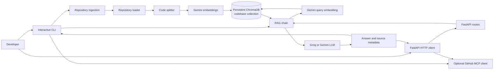
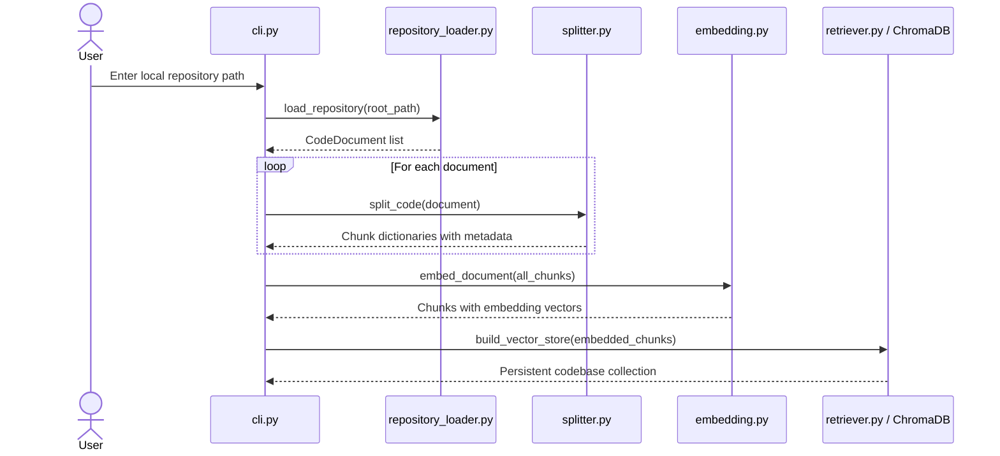
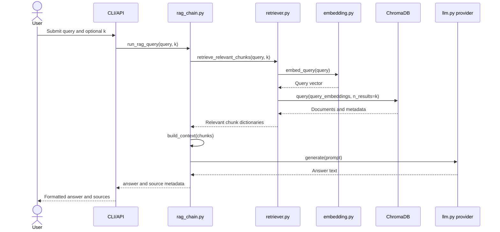

# CodeMind AI — Complete Project Context

## Documentation status

This document describes the implementation found in the repository at the time
of analysis. It is intended as source material for a Lab ESE mini-project
report. Claims are based on the Python source, configuration schema,
dependency manifest, README, test runner, and runtime checks. Secrets from
`.env` are intentionally excluded.

Repository: `https://github.com/Suyog-Repal/codemind-ai`  
Branch observed: `main`  
Latest commit observed: `7f6fd8b readme fixed`  
Public deployment URL: **Not available in the repository or runtime evidence.**

## 1. Project title

**CodeMind AI — RAG-Based Repository Intelligence and Question Answering
System**

## 2. Abstract

CodeMind AI is a Python application that analyzes a local source repository
using retrieval-augmented generation (RAG). It loads supported source files,
splits them into chunks, generates Gemini embeddings, stores the vectors and
metadata in a persistent ChromaDB collection, retrieves semantically relevant
chunks for a user question, and sends the resulting context to a configured
Groq or Gemini language model.

The project exposes the capabilities through an interactive CLI and a
FastAPI REST API. In addition to RAG questions, the implementation includes
LLM-assisted bug detection, Python function explanation, module documentation,
README generation, AI file proposals, and optional GitHub MCP tool listing.
There is no implemented frontend workflow in the current source tree.

## 3. Introduction

Large repositories are difficult to understand through manual file browsing.
CodeMind AI addresses this problem by turning repository files into searchable
vector representations and using retrieved code as context for language-model
answers. The system is designed for local repository analysis rather than
general web search or autonomous software deployment.

The current implementation is a CLI/API prototype. It depends on external
Gemini embedding and LLM services, an optional Groq LLM service, and an
optional GitHub MCP service.

## 4. Background and motivation

Traditional repository inspection requires a developer to locate files,
understand relationships, and repeatedly search for relevant code. A RAG
system can reduce this effort by:

1. indexing repository content once;
2. finding semantically related chunks for a question; and
3. giving an LLM the retrieved code instead of the entire repository.

The project also provides focused utilities for code review and documentation
generation. These utilities reuse the same configured LLM and, where useful,
the existing vector store.

## 5. Problem statement

Developers need a practical way to ask questions about an unfamiliar local
codebase and receive answers grounded in repository content. The system must
load relevant files, create searchable embeddings, retrieve useful context,
and expose the result through a usable CLI or API while keeping provider
credentials outside source code.

## 6. Objectives

- Load supported files from a local repository.
- Exclude common generated, dependency, and build directories.
- Split source files into manageable code chunks.
- Generate document embeddings using Gemini.
- Persist embeddings and metadata in ChromaDB.
- Retrieve top-k chunks for a natural-language question.
- Generate an answer using Groq or Gemini.
- Display source file and estimated line metadata.
- Provide CLI and FastAPI access.
- Provide supplementary code-analysis and documentation utilities.
- Keep GitHub MCP optional for application startup.

## 7. Scope

### Implemented scope

| Area | Status | Evidence |
|---|---|---|
| Local repository ingestion | Implemented | `repository_loader.py:22-31`, `cli.py:131-160` |
| Code-aware chunking | Implemented | `splitter.py:12-39` |
| Gemini document and query embeddings | Implemented | `embedding.py:8-51` |
| Persistent ChromaDB storage | Implemented | `retriever.py:5-43` |
| Semantic top-k retrieval | Implemented | `retriever.py:51-56` |
| LLM answer generation | Implemented | `rag_chain.py:14-25`, `llm.py:19-79` |
| Source metadata display | Implemented | `splitter.py:42-52`, `cli.py:173-207` |
| Interactive CLI | Implemented | `cli.py:1-418` |
| FastAPI routes | Implemented | `routes.py:1-58` |
| Bug detection | Implemented with model-dependent quality | `code_analysis.py:28-40` |
| Function explanation | Implemented for Python functions | `code_analysis.py:6-25` |
| Documentation generation | Implemented with model-dependent quality | `documentation.py:5-50` |
| File proposal and approved write | Implemented, with path-safety limitations | `file_creator.py:7-48` |
| GitHub MCP tool listing | Implemented but externally dependent | `mcp_client.py:13-72`, `cli.py:365-379` |
| API health check | Implemented and tested | `app.py:40-41` |

### Partial, externally dependent, or unavailable scope

- **RAG quality:** the code path is implemented, but answer accuracy and
  retrieval quality are not quantitatively evaluated.
- **Embedding ingestion:** depends on Gemini credentials and available quota.
- **LLM features:** depend on provider credentials, model availability, and
  provider quotas.
- **GitHub MCP:** optional, but the current client has an authentication-header
  implementation that must be independently verified against the target MCP
  service.
- **Frontend:** no frontend files were found in the current `frontend`
  directory listing; no frontend workflow is implemented.
- **Deployment:** no deployment configuration or public deployment evidence was
  found.

## 8. Existing system and proposed system

### Existing/manual approach

A developer manually opens repository files, searches for symbols, reads
related modules, and writes explanations or documentation.

### Proposed CodeMind AI approach

CodeMind AI automates repository indexing and retrieval, then uses a language
model to produce a contextual answer. The CLI provides a guided workflow,
while FastAPI exposes the same core operations as HTTP endpoints.

## 9. System architecture

### 9.1 Major components

| Component | Responsibility | Source |
|---|---|---|
| CLI | Prompts for repository paths, ingestion, feature selection, and output formatting | `cli.py` |
| FastAPI application | Creates the application, registers routes, handles health and optional MCP lifecycle | `app.py` |
| API router | Defines request models and feature endpoints | `routes.py` |
| Repository loader | Walks a local directory, filters files, reads content, assigns language metadata | `repository_loader.py` |
| Splitter | Splits content and attaches chunk metadata | `splitter.py` |
| Embedding adapter | Calls Gemini embeddings, batches documents, retries quota errors | `embedding.py` |
| Retriever | Creates/loads ChromaDB and performs similarity queries | `retriever.py` |
| RAG chain | Combines retrieved context with the user query and calls the LLM | `rag_chain.py` |
| LLM adapter | Supports Gemini and Groq generation and streaming | `llm.py` |
| Code-analysis services | Explains Python functions and requests LLM bug analysis | `code_analysis.py` |
| Documentation services | Generates module documentation and README content | `documentation.py` |
| File creator | Generates file proposals and writes confirmed files | `file_creator.py` |
| MCP client | Connects to an optional streamable HTTP MCP service | `mcp_client.py` |

### 9.2 System architecture diagram

### 9.3 Data flow

The ingestion flow produces `CodeDocument` objects, chunk dictionaries, vector
lists, and ChromaDB records. A query produces a query vector, retrieved
documents and metadata, a formatted context string, an LLM prompt, and a
response dictionary containing `answer` and `sources`.

## 10. Application workflows

### 10.1 Repository ingestion workflow

### 10.2 RAG question-answering workflow

## 11. Technologies used

Versions below are from `requirements.txt`; the unpinned `groq` package has no
version in that file.

| Technology | Actual package/library | Version | Purpose | Used in |
|---|---|---:|---|---|
| Python web framework | `fastapi` | 0.116.1 | HTTP application and routing | `app.py`, `routes.py` |
| ASGI server | `uvicorn` | 0.35.0 | Runs the FastAPI app | documented command |
| Validation/settings | `pydantic`, `pydantic-settings` | 2.13.4, 2.14.2 | Request models and environment-backed settings | `routes.py`, `config.py` |
| Environment loading | `python-dotenv` | 1.2.2 | `.env` support through settings | `config.py` |
| LLM SDK | `groq` | unpinned | Groq chat completion generation | `llm.py` |
| Gemini SDKs | `google-genai`, `google-generativeai` | 2.14.0, 0.8.6 | Gemini generation/embedding dependencies | `llm.py`, `embedding.py` |
| LangChain Gemini | `langchain-google-genai` | 4.3.2 | Gemini embeddings adapter | `embedding.py` |
| Text splitting | `langchain-text-splitters` | 1.1.2 | Recursive code-aware splitting | `splitter.py` |
| Vector database | `chromadb` | 1.5.9 | Persistent vector collection and similarity search | `retriever.py` |
| Chroma integration | `langchain-chroma` | 1.1.0 | Declared dependency; direct retriever uses Chroma client | `requirements.txt` |
| Python parsing | Standard-library `ast` | Python runtime | Function source extraction | `code_analysis.py` |
| MCP client | `mcp` | 2.0.0 | Streamable HTTP MCP connection | `mcp_client.py` |
| HTTP transport | `httpx`, `httpx-sse` | 0.28.1, 0.4.3 | MCP/HTTP support | `requirements.txt`, MCP stack |
| Token counting | `tiktoken` | 0.13.0 | Token count helper | `llm.py` |
| Complexity analysis | None currently | — | Removed from the current project | not implemented |
| Frontend framework | None | — | No frontend implementation in current tree | not implemented |

### Effective configuration observed

The non-secret effective settings read during analysis were:

| Setting | Observed value |
|---|---|
| `LLM_PROVIDER` | `groq` |
| `EMBEDDING_MODEL` | `models/gemini-embedding-001` |
| `GROQ_MODEL` | `openai/gpt-oss-20b` |
| `VECTOR_DB_PATH` | `./vector_db` |
| `CHUNK_SIZE` | `1200` |
| `CHUNK_OVERLAP` | `100` |
| `ALLOWED_EXTENSIONS` default | `.py`, `.js`, `.ts`, `.go`, `.java`, `.md` |
| `MAX_FILE_SIZE_KB` default | `1042` |

Secret values were not inspected or included.

## 12. Detailed implementation

### 12.1 Configuration

`config.py:5-41` defines `Settings`, including provider selection, API key
fields, embedding settings, ChromaDB path, chunk parameters, MCP URLs/tokens,
allowed extensions, and file-size limits. `get_settings()` at
`config.py:44-45` caches the settings object using `lru_cache`.

### 12.2 Repository loader

`repository_loader.py:6-12` defines `CodeDocument`. The loader at
`repository_loader.py:22-31` walks the supplied local root. `IGNORE_DIRS` and
`LANGUAGE_BY_EXT` are defined at `repository_loader.py:15-20`.
`should_include()` at `repository_loader.py:34-44` applies extension and size
filters. `read_file_with_metadata()` at `repository_loader.py:47-57` reads
UTF-8 text with ignored decoding errors.

### 12.3 Code splitting

`split_code()` at `splitter.py:12-35` chooses a language-specific
`RecursiveCharacterTextSplitter` where available, using configured chunk size
and overlap. `attach_metadata()` at `splitter.py:42-52` stores content, file
path, language, chunk index, and estimated start/end lines. The estimate is
implemented by `estimate_line_range()` at `splitter.py:55-61` using
`str.find()` and newline counts.

### 12.4 Embeddings

`get_embedding_client()` at `embedding.py:8-15` constructs
`GoogleGenerativeAIEmbeddings` using the configured Gemini model and key.
`embed_document()` at `embedding.py:18-49` sends document text in batches capped
at 100, retries recognized quota errors, and adds vectors to chunk dictionaries.
`embed_query()` at `embedding.py:52-54` embeds a question for retrieval.

The retry behavior sleeps for `EMBEDDING_RETRY_DELAY_SECONDS` between attempts.
It raises a clear runtime error after configured retries when a Gemini quota
remains unavailable.

### 12.5 Vector database

`get_chroma_client()` at `retriever.py:5-7` creates a persistent client at
`VECTOR_DB_PATH`. `build_vector_store()` at `retriever.py:10-42` deletes the
existing `codebase` collection, creates a new one, and adds IDs, embeddings,
documents, and metadata. `load_vector_store()` at `retriever.py:45-47` loads
or creates the collection.

`retrieve_relevant_chunks()` at `retriever.py:50-56` embeds the query, calls
ChromaDB `query()` with `n_results=k`, and formats the first result lists.
`format_results()` at `retriever.py:59-68` returns content and metadata pairs.

### 12.6 LLM integration

`GeminiLLM` at `llm.py:16-43` calls the Google GenAI client for generation and
streaming. `GroqLLM` at `llm.py:47-79` calls Groq chat completions for
generation and streaming. `get_llm_client()` at `llm.py:85-101` selects the
provider based on `LLM_PROVIDER` and raises an error for unsupported values.

`build_prompt()` at `llm.py:106-137` provides templates for QA, bug finding,
docstring generation, and file creation. `count_tokens()` at `llm.py:140-143`
uses `tiktoken`; it is a helper and is not part of the RAG request path.

### 12.7 RAG orchestration

`build_context()` at `rag_chain.py:5-11` converts retrieved chunks into
headers containing file path and line range followed by chunk content.
`run_rag_query()` at `rag_chain.py:14-25` performs retrieval, context
construction, prompt construction, provider selection, generation, and returns
the answer plus source metadata.

### 12.8 CLI

The CLI starts at `main()` in `cli.py:410-438`. It asks for a local directory,
calls `ingest_repository()` at `cli.py:131-160`, and then enters the menu loop.
`MENU` is defined at `cli.py:390-400`.

The terminal formatter is implemented by `section()`, `ok()`, `err()`,
`info()`, and `print_ai_text()` at `cli.py:31-128`. It converts common
Markdown headings, tables, lists, and fenced code into readable terminal
output. This is presentation logic only and does not change RAG prompts or
responses.

### 12.9 FastAPI

`app.py:10-22` creates the FastAPI application, adds permissive CORS
middleware, includes the router under `/api`, and constructs the MCP client.
Startup and shutdown lifecycle functions are at `app.py:25-38`; MCP failures
are logged as warnings so the API can continue. `/health` is at
`app.py:40-41`.

Request models and routes are defined in `routes.py:10-58`. The compatibility
package `api/routes.py` re-exports the flat `routes.router`; `rag/` and
`services/` similarly provide compatibility wrappers for the flattened
project layout.

## 13. RAG pipeline — complete trace

| Step | Actual implementation | Source reference |
|---:|---|---|
| 1. Repository path input | CLI prompts for a local directory and loops until `os.path.isdir(root)` is true | `cli.py:414-420` |
| 2. Repository loading | `load_repository(root_path)` walks files and creates `CodeDocument` values | `cli.py:136-140`, `repository_loader.py:22-31` |
| 3. File support/exclusions | Extensions from settings; excludes `.git`, dependency/build/cache directories and oversized files | `repository_loader.py:15-20`, `34-44` |
| 4. File processing | UTF-8 read with `errors="ignore"`, language and byte-size metadata | `repository_loader.py:47-57` |
| 5. Chunking | Recursive character splitting, language-aware for Python/JS/TS/Java/Go | `splitter.py:12-35` |
| 6. Chunk size/overlap | Defaults are 1200/100; settings can override them | `config.py:22-23`, `splitter.py:19-29` |
| 7. Chunk metadata | Content, file path, language, chunk index, estimated start/end lines | `splitter.py:42-52` |
| 8. Embedding model | Gemini `models/gemini-embedding-001` through LangChain Google GenAI | `config.py:12`, `embedding.py:8-15` |
| 9. Vector database | Persistent ChromaDB at `./vector_db`, collection `codebase` | `config.py:22`, `retriever.py:5-7`, `10-25` |
| 10. Storage | IDs combine file path and chunk index; vectors, documents, and metadata are added | `retriever.py:27-42` |
| 11. Question processing | Query is accepted by CLI or `QueryRequest`; it is passed to `run_rag_query` | `cli.py:169-179`, `routes.py:12-15`, `32-34` |
| 12. Retrieval | Query embedding is sent to ChromaDB with `n_results=k` | `retriever.py:50-56` |
| 13. Context construction | File/line header plus content joined with separators | `rag_chain.py:5-11` |
| 14. Prompt construction | QA template includes context and question and asks for grounded output | `llm.py:106-119` |
| 15. LLM provider/model | Provider selected from `LLM_PROVIDER`; observed effective provider is Groq and model is `openai/gpt-oss-20b` | `llm.py:85-101`, `config.py:17-19` |
| 16. Generation | Provider `generate()` returns answer text | `rag_chain.py:20`, `llm.py:25-31`, `61-67` |
| 17. Source handling | Metadata is returned; line numbers are estimated during splitting | `splitter.py:42-61`, `rag_chain.py:22-25` |
| 18. Display | CLI prints formatted answer and a deduplicated source table | `cli.py:181-207` |

The RAG implementation is present and was exercised with an actual query
during prior project validation. The quality of answers, citation correctness,
latency, and retrieval accuracy have not been benchmarked.

## 14. CLI implementation

The following are the current menu options from `cli.py:390-400`.

| Option | Purpose | Main functions | Inputs | Output/status |
|---:|---|---|---|---|
| 1 | Ask a repository question | `feature_query()` → `run_rag_query()` | Question and optional `k` | Answer and source table |
| 2 | Detect bugs | `feature_bugs()` → `detect_bugs()` | Existing file path | Severity, line, issue, suggestion |
| 3 | Explain a function | `feature_explain()` → `explain_function()` | Existing Python file and function name | LLM explanation |
| 4 | Generate module documentation | `feature_module_docs()` → `generate_module_docs()` | Existing file path | Generated documentation |
| 5 | Generate README | `feature_readme()` → `generate_readme()` | Existing repository directory | Preview and optional write to README.md |
| 6 | Propose/create a file | `feature_propose_file()` → `propose_new_file()` and `apply_approved_file()` | Description, optional context, approval | Proposal and optional written file |
| 7 | List GitHub MCP tools | `feature_mcp_tools()` → `get_github_mcp_client()` | MCP configuration | Tool names/descriptions or connection error |
| 8 | Re-ingest repository | `feature_reingest()` → `ingest_repository()` | New local directory | Rebuilt vector store |
| 0 | Exit | `main()` | None | Terminates CLI |

The CLI requires external services for ingestion and LLM-backed options. It
does not accept a GitHub URL as a repository path; a repository must be cloned
locally first.

## 15. API documentation

Routes are registered by `app.py:22` with prefix `/api` and defined in
`routes.py`.

| Endpoint | Method | Request parameters/body | Response | Auth |
|---|---|---|---|---|
| `/health` | GET | None | `{"status": "ok"}` | None |
| `/api/query` | POST | JSON `{ "query": string, "k": integer = 5 }` | `{ "answer": string, "sources": [...] }` | None |
| `/api/analyze/bugs` | POST | Query parameter `file_path` | `{ "bugs": [...] }` | None |
| `/api/analyze/explain` | POST | JSON `{ "file_path": string, "function_name": string }` | `{ "explanation": string }` | None |
| `/api/docs/module` | POST | Query parameter `file_path` | `{ "docs": string }` | None |
| `/api/docs/readme` | POST | Query parameter `root_path` | `{ "readme": string }` | None |
| `/api/files/propose` | POST | JSON `{ "description": string, "context_query": string|null }` | `FileProposal` object | None |
| `/api/files/approve` | POST | JSON `{ "proposal": object, "approved": boolean }` | Write/rejection status object | None |

The request models are `QueryRequest`, `ExplainRequest`,
`FileProposalRequest`, and `FileApprovalRequest` at `routes.py:10-29`.
Pydantic validates required fields and basic types. There is no application
authentication or authorization layer. Backend exceptions from feature
functions are not consistently translated into custom HTTP error responses.

There are no documented planned endpoints in the source. The endpoints above
are the implemented route set observed at runtime.

## 16. Results and observations

### Runtime evidence

| Check | Result |
|---|---|
| Python compilation | Passed for 29 project Python files |
| FastAPI import | Passed |
| `/health` TestClient request | HTTP 200, body `{"status": "ok"}` |
| Registered API routes | Seven `/api` feature routes plus `/health` |
| Repository loader measurement | 30 documents loaded from the current project |
| Current splitter measurement | 95 chunks generated from those 30 documents |
| Current persistent ChromaDB state | 112 records in `codebase` collection |
| Manual test names | `mcp`, `embed`, `ingest`, `query`, `bugs` |
| Frontend inspection | No frontend files found in the `frontend` directory listing |

The 95 freshly computed chunks and 112 persisted records are not presented as
an accuracy or performance benchmark. The persisted collection can contain
records from a different or earlier ingestion because ingestion replaces the
collection only when `build_vector_store()` runs successfully.

### Tests and methodology

The project contains a manual test runner, not a conventional automated test
suite. `test_runner.py` defines:

- `test_embed()` for embedding a query and a small document;
- `test_ingest()` for loading this project, splitting, embedding, and building
  ChromaDB;
- `test_query()` for a RAG question against the vector store;
- `test_bugs()` for LLM bug detection on `llm.py`;
- `test_mcp()` for MCP connection and tool listing.

The test runner supports `all` and individual names through `test_runner.py:116-145`.
The source contains no assertions for answer quality, citation accuracy,
retrieval recall, latency, or security behavior.

### Not tested or not established

- No reproducible retrieval-accuracy benchmark.
- No response-time or throughput benchmark.
- No automated end-to-end test covering all API routes.
- No browser/frontend test.
- No deployment or production hosting test.
- No measured success rate for external LLM/MCP calls.
- No formal security penetration test.

## 17. Security and limitations

### Credential handling

Credentials are modeled as environment-backed settings in `config.py`; source
files do not hardcode the values. `.env` is used as the settings file and must
not be committed or exposed. This report does not include secret values.

### Authentication and authorization

The FastAPI routes have no authentication or authorization. CORS is configured
with wildcard origins and all methods/headers at `app.py:14-19`. The API
should therefore be treated as a local development service unless placed
behind an authenticated, restricted network boundary.

### File and repository access

The CLI reads any local directory supplied by the user, subject to extension
and size filters. API file paths are accepted as parameters without a
repository-root sandbox in `routes.py`. The file-creation implementation
strips leading separators but does not fully canonicalize or reject `..`
segments before writing (`file_creator.py:25-44`). This is a security
limitation for untrusted API callers.

### External-service and quota dependence

Gemini embeddings are required for ingestion and retrieval. Free-tier quota
exhaustion can stop ingestion or query embedding. Groq/Gemini generation also
requires valid credentials and an available model. GitHub MCP is optional for
startup but requires its own token and reachable service for tool listing.

### Error handling

The CLI catches many feature exceptions and displays them. FastAPI startup
catches MCP connection failures and logs a warning, preserving API startup.
The API feature handlers themselves do not provide a uniform exception
translation layer. `detect_bugs()` returns a fallback issue when model output
is not valid JSON (`code_analysis.py:28-40`), which is a functional fallback
but not a guarantee of correct analysis.

### Model output limitations

LLM-generated explanations, bug reports, documentation, README text, and file
proposals are not independently validated. The QA prompt requests grounded
answers, but prompt instructions alone do not prove factual correctness.

## 18. Conclusion

CodeMind AI implements a complete prototype RAG path from local repository
loading through Gemini embeddings, persistent ChromaDB retrieval, and Groq or
Gemini answer generation. It also provides a practical CLI and a set of
FastAPI endpoints around repository intelligence tasks.

The implementation is suitable for a mini-project demonstration and further
evaluation. It should not be described as production-ready without adding
authentication, path isolation, stronger error contracts, automated tests,
provider-independent evaluation, and deployment hardening.

## 19. Future scope

The following are improvement opportunities, not currently implemented
features:

- Add authenticated API access and authorization.
- Restrict API file operations to an approved repository root.
- Add path canonicalization and traversal protection.
- Add automated unit and integration tests.
- Add retrieval and answer-quality evaluation datasets.
- Add citation validation against retrieved chunks.
- Add a frontend if a browser workflow is required.
- Add provider-independent or local embedding options.
- Add ingestion progress, cancellation, and incremental indexing.
- Add deployment configuration and observability.

## 20. GitHub and deployment links

- GitHub repository: https://github.com/Suyog-Repal/codemind-ai
- Public deployment: **Not available / not verified**

## 21. References

Project-local references:

1. `app.py` — FastAPI application lifecycle and health endpoint.
2. `routes.py` — FastAPI request models and feature routes.
3. `cli.py` — interactive CLI, ingestion workflow, menu, and output formatting.
4. `repository_loader.py` — local file loading and filtering.
5. `splitter.py` — language-aware chunking and source metadata.
6. `embedding.py` — Gemini embedding client, batching, and retry behavior.
7. `retriever.py` — ChromaDB persistence and similarity retrieval.
8. `rag_chain.py` — RAG context and answer orchestration.
9. `llm.py` — Gemini/Groq adapters and prompt templates.
10. `code_analysis.py` — function extraction, explanations, and bug detection.
11. `documentation.py` — module, repository summary, and README generation.
12. `file_creator.py` — AI proposal and approved file writing.
13. `mcp_client.py` — optional GitHub MCP streamable HTTP client.
14. `config.py` — environment-backed configuration.
15. `requirements.txt` — declared dependency versions.
16. `test_runner.py` — available manual tests.
17. `README.md` — project setup and usage documentation.

External technologies used by the implementation include FastAPI, Uvicorn,
Pydantic Settings, Google GenAI, LangChain Google GenAI, LangChain text
splitters, ChromaDB, Groq, and MCP. Their exact declared versions are listed
in `requirements.txt`.
